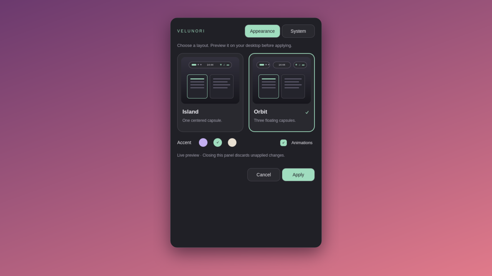

# Velunori

A complete desktop suite for Omarchy: floating bars, coordinated panels, a Serene lock screen and a graphite, lavender and mint theme.



## Install

Use an **unlocked Omarchy desktop terminal**, as your normal user, without `sudo`:

```bash
curl -fsSL https://velunori.github.io/install.sh | bash -s -- --all
```

Omit `--all` to choose components interactively, or pick them on [velunori.github.io](https://velunori.github.io/). The script is self-contained: it carries the runtime files of every component from this repository's pinned submodules, so nothing is cloned and no system packages are installed. It shows the plan, checks prerequisites and asks you to type `INSTALL` before changing anything.

Prefer to read it first? Download it, compare its checksum with [`install.sh.sha256`](https://velunori.github.io/install.sh.sha256), then run the same actions locally:

```bash
curl -fsSLO https://velunori.github.io/install.sh
bash install.sh plan --all
bash install.sh check --all
bash install.sh install --all
bash install.sh status
```

Select individual components with `--components bar,clock,control-center`. The shared library is added automatically. Your current bar, theme and lock screen stay unless you select `bar`, `theme` or `lockscreen`. `--cloud` downloads the calendar's Google/iCloud libraries into its private environment; without it the clock and local calendars still work. See the [installer guide](installer/README.md) for ownership, receipts and recovery.

## What's included

| Component | Role |
| --- | --- |
| [lib](https://github.com/Velunori/lib) | Shared design kit, palette, branding and panel geometry; installed automatically |
| [bar](https://github.com/Velunori/bar) | Optional Island and Orbit floating bars with appearance settings |
| [clock](https://github.com/Velunori/clock) | Clock, editable local calendars and Google/iCloud synchronization |
| [control-center](https://github.com/Velunori/control-center) | Sound, displays, network, capture, reminders and appearance |
| [notifications](https://github.com/Velunori/notifications) | Notification cards and session-only history |
| [menu](https://github.com/Velunori/menu) | Two-pane Omarchy command menu and prompts |
| [weather](https://github.com/Velunori/weather) | Saved cities and a weekly forecast |
| [update](https://github.com/Velunori/update) | A progress window for Omarchy's own system updater |
| [lockscreen](https://github.com/Velunori/lockscreen) | Serene presentation with Omarchy's unchanged lock/PAM service |
| [theme](https://github.com/Velunori/theme) | Coordinated palette, Dusk wallpaper and window styling |

Every feature component works on the stock Omarchy bar. Each repository has its own screenshots, requirements, checks and limitations.

## After installation

With Floating Bars installed, open **Appearance** in Control Center to choose Island or Orbit, an accent and animations. Existing Omarchy widget order and settings are preserved where the components support it.

The Serene lock screen has a preview that does not lock or accept passwords: `omarchy-shell lock preview`. Click it to dismiss. Weather requires network access. Notification history lasts only for the current session; calendar data persists. Connect Google (desktop OAuth) or iCloud (app-specific password) explicitly in the calendar panel; see the [calendar guide](https://github.com/Velunori/clock/blob/main/docs/calendar-sync.md).

## Recovery

The installer keeps a receipt in `${XDG_DATA_HOME:-$HOME/.local/share}/velunori/installation`, with the exact pre-install shell configuration in `backups/shell.before.json`. A failed activation restores that configuration when it is safe to do so and moves new files aside instead of deleting them. Run `bash install.sh status` to see what was installed. The [installer guide](installer/README.md#failure-and-recovery) covers manual recovery, the theme and the bar.

Managed in-place upgrades and selection-aware removal are not implemented yet.

## Compatibility

Developed and checked on **Omarchy 4.5.0-3**. See the [compatibility record](docs/compatibility.md) for the exact environment, pinned revisions and live checks still pending. Other Omarchy versions are unverified.

## Development

The submodules in `components/` are the release: each is pinned to a reviewed commit, and the installer is built only from those clean pins.

```bash
git clone --recurse-submodules https://github.com/Velunori/velunori.git
cd velunori
python3 -B -m unittest discover -s installer/tests -v
python3 installer/build.py --output /tmp/velunori-install.sh
```

Each component's own `scripts/check.sh` runs from this layout, for example `bash components/clock/scripts/check.sh`. To release a component change, merge it in its repository, move the pin here, rebuild the installer and update the website download. Tests use temporary homes and stand-in commands; they do not install the suite, alter the desktop, lock the session or run the real updater.

## Contributing and support

For a new plugin, read the [authoring guide](https://github.com/Velunori/.github/blob/main/docs/plugin-authoring.md) and [suite inclusion process](https://github.com/Velunori/.github/blob/main/docs/suite-inclusion.md). Read the shared [contribution guidelines](https://github.com/Velunori/.github/blob/main/CONTRIBUTING.md) for development setup and validation.

Use the [issue forms](https://github.com/Velunori/velunori/issues/new/choose) for installation problems, suggestions or questions; component issues belong in their own repositories. Include your Omarchy version and relevant error output, with credentials removed. See [support](https://github.com/Velunori/.github/blob/main/SUPPORT.md) and our [Code of Conduct](https://github.com/Velunori/.github/blob/main/CODE_OF_CONDUCT.md). Report suspected vulnerabilities through [private security reporting](https://github.com/Velunori/.github/blob/main/SECURITY.md).

## License

MIT. See [LICENSE](LICENSE); each component retains its own license and third-party notices.
